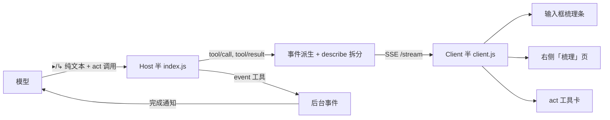

# dsh-better-tooluse · 工具梳理

> Decision-stream visibility for DeepSeek Harness: every tool call carries a `describe`, decisions are narrated in plain text, and live act cards sit in the sidebar.

[](LICENSE)
[](package.json)
[](tests/core.test.mjs)

让 Agent 的每次思考与工具调用可见、可纠偏的 DSH 插件。它做三件事：把判断写成纯文字工作日志、强制每次工具调用携带 `describe`、并在右侧「梳理」面板里实时展示 act 卡片。

## 特性

- **四类播报行**（可见正文，纯文本）：`◎ 目标`、`▸ 决策：<思考结果> → <本步作用>`、`↳ 发现`、`⟲ 调整`。
- **强制 `act` 外包装**：普通工具必须通过 `act({ describe, tool, input })` 调用；直连会被 Host 护栏拒绝，`describe` 缺省即失败。
- **act 卡片**：输入框梳理条、工具卡、右侧「梳理」页顶部实时显示工具名 / 思考结果 / 作用 / 状态 / 耗时 / 结果摘要；支持展开全文、状态与工具筛选、运行中置顶。
- **后台事件 `event`**：长任务交给后台运行，完成后结果自动回到上下文并触发新一轮；支持 `list` / `kill`。
- **阶段梳理卡**：可选配合 dsh-genui，在关键节点输出精简 `dsh-ui` 卡片。
- **配置化与测试**：护栏强度、豁免表、协议档位、面板显隐均可配；附带 `node:test` 单元测试。

## 仓库结构

| 路径 | 作用 |
| --- | --- |
| `index.js` | Host 半：系统提示协议、`act` / `event` 工具、护栏、SSE 路由、事件派生 |
| `client.js` | Client 半：输入框梳理条、右侧「梳理」页、act 工具卡、SSE 存储 |
| `lib/protocol.js` | 常驻协议文本（`normal` / `quiet` 两档） |
| `lib/config.js` | 配置默认值与归一化 |
| `lib/guard.js` | describe 强制护栏的纯函数判定 |
| `SKILL.md` | 打包 skill：`describe`/播报/梳理卡/事件化的完整规则 |
| `tests/core.test.mjs` | 单元测试 |
| `cordis.patch.yml` | bundle 补丁（插入 `dsh-better-tooluse` 行） |

## 环境要求

- DeepSeek Harness `>=0.2.2-rc.1 <0.3.0`（profile 模式）。
- 可选：`dsh-better-sidebar`（右侧「梳理」页；未安装时自动降级为只有输入框梳理条）、`@changfenhuang/dsh-genui`（阶段梳理卡）、`dsh-ops`（本插件已适配 `ops_*` 工具名替换）。

## 安装

### 方式一：通过 plugin_manager（推荐）

在 DSH 会话里让 Agent 执行（`<path-to-this-checkout>` 换成仓库绝对路径）：

```text
plugin_manager action=install_bundle target=link:<path-to-this-checkout>
```

安装会写入 profile 的 `dependencies` 与 `dsh.profile.bundles`，随后自动激活。

### 方式二：CLI

```bash
dsh plugin --profile <profile> install <path-to-this-checkout>
```

### 手动安装

1. 在 profile 的 `package.json` 中加入 `"dsh-better-tooluse": "link:<path-to-this-checkout>"`；
2. 把 `dsh-better-tooluse` 追加到 `dsh.profile.bundles`；
3. 重启 DSH，或在插件列表里把 `include:dsh-better-tooluse` 关→开。

> Host 代码修改后需要 `set_plugin` 关→开（或重启）才生效；`client.js` 修改会随客户端图变更热加载。

## 快速开始

模型在调用工具前会这样播报（纯文本，UI 不能替代）：

```text
▸ 决策：需要确认依赖版本 → 读取 package.json
```

工具调用本身通过 act 包装：

```text
act({ describe: "需要确认依赖版本 → 读取 package.json", tool: "read", input: { path: "package.json" } })
```

打开右侧「梳理」页：点输入框下方梳理条右侧的「梳理」按钮，或在右侧栏的 + 菜单里选「梳理」。

## 配置

在插件行直接写配置键（无需 schema；未知键忽略，非法值回退默认）：

| 键 | 默认 | 说明 |
| --- | --- | --- |
| `enforceDescribe` | `hard` | `hard` 拒绝未包装的普通调用；`soft` 只记录；`off` 关闭护栏 |
| `exemptTools` | `[]` | 额外允许直连的工具名（叠加内置豁免表） |
| `protocolTone` | `normal` | `normal` 含阶段梳理卡与事件化说明；`quiet` 仅核心规则 |
| `eventEnabled` | `true` | 是否注册后台 `event` 工具 |
| `backfillEvents` | `120` | 面板打开时回填事件数（0 关闭） |
| `autoEventizeMs` | `60000` | act 包的工具超过该毫秒数时自动转后台事件（0 关闭） |

> 设置页（DSH Settings → dsh-better-tooluse）提供两个开关：**强制 act describe** 与 **自动事件化**，以及自动事件化阈值 `autoEventizeMs`；修改后重新挂载生效。
| `eventProgressMs` | `5000` | 后台事件进度广播间隔（0 关闭） |
| `maxResultChars` | `2000` | act 卡片展开时保留的结果全文长度 |
| `showDockStrip` | `true` | 是否显示输入框梳理条 |
| `showActCards` | `true` | 梳理页是否显示 act 卡片区 |
| `actCardLimit` | `10` | 梳理页 act 卡片上限（1–30） |

浏览器半可通过 `GET /plugins/dsh-better-tooluse/config` 读取 `showDockStrip` / `showActCards` / `actCardLimit`。

## 架构



- 传输：Host `webServer` 包私有前缀路由（`/plugins/dsh-better-tooluse/*`），不依赖 typert 生成物，不 import 任何 `@deepseek-ai/*` 包。
- 事件派生：`assistant/message` 的可见正文拆出播报行与 `describe`；`tool/call` / `tool/result` 生成运行中→完成的工具事件。
- 与 dsh-ops 兼容：不假设工具名，`read/glob/grep` 被替换为 `ops_*` 也照常工作。

## 开发

无需构建：Host 是 ESM，Client 通过 `window.__ModuleLoader__` 加载并使用 React `h()`。

```bash
npm test          # node --test tests/core.test.mjs（当前 9 个用例）
```

## 已知限制

- DSH 会把原生工具行归入可折叠的「已调用工具」区；act 卡片由插件自行渲染（梳理条/面板/工具卡），不改变内核对分组的控制。
- 被 act 包装后不再显示各工具的原生富卡片（diff/搜索/终端），统一为 describe 优先的 act 卡。
- 后台事件表仅存在于内存，插件重载/DSH 重启后不保留历史。
- 面板不提供「跳转到对话内对应工具卡」（需要 Chat owner 的 `inspectCall` 通道，当前公开槽位未暴露）。
- 内建豁免表覆盖常见控制类工具；新插件的控制工具可能需要加入 `exemptTools`。
- 仅在 Windows + desktop profile 实测；其他平台未验证。

## 更新记录

见 [CHANGELOG.md](CHANGELOG.md)。

## 许可证

[MIT](LICENSE) © 2026 FunnyBishop
